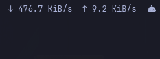

# Network Speed Lite

A tiny, zero-config Omarchy bar widget that shows live download and upload rates (`↓ 1.2 MiB/s  ↑ 84.0 KiB/s`), updated every two seconds.



- Sums **active physical interfaces only** (those with a backing device in `/sys/class/net`), so loopback, VPN tunnels, bridges and Docker interfaces never double-count the same traffic.
- Switches between KiB/s and MiB/s automatically.
- When an interface reconnects or its counters reset, it starts a fresh baseline instead of showing a spike.
- Shows `offline` when no physical interface is up. The tooltip lists the interfaces being counted.
- Works in horizontal and vertical bars.

## Clicks

- **Left click** opens a details popup: current, peak and session-total download/upload, plus a per-interface breakdown (physical interfaces only). Click again or outside it to close.
- **Right click** switches between the normal view and a **compact view**: just `↓ ↑` arrows that light up and blink while traffic above 1 KiB/s flows in that direction, and stay dim when idle.

The chosen view is remembered across restarts in `~/.local/state/omarchy-network-speed-lite/mode` (created automatically).

No settings to configure, no network requests, no logs, no extra packages: just Python 3's standard library reading Linux sysfs counters.

Want an interface picker, colors and thresholds? See the fuller [Network Speed](https://github.com/csawy3r/omarchy-network-speed) plugin. This one is the minimal option.

## Requirements

- Omarchy with the Quickshell-based shell (plugin `schemaVersion` 1)
- `/usr/bin/python3` (preinstalled on Omarchy)

## Install

```bash
omarchy plugin add https://github.com/zejzl/omarchy-network-speed-lite.git --enable
```

It lands in the right section of the bar by default. You can move it from the bar settings.

## Remove

```bash
omarchy plugin remove zejzl.network-speed-lite
```

That removes the plugin folder and its bar entry. The only other file is the small view-mode file above; delete `~/.local/state/omarchy-network-speed-lite` if you want it gone too.

## How it works

`BarWidget.qml` starts `traffic.py`, which reads `rx_bytes` and `tx_bytes` for each up physical interface every 2 seconds and prints one JSON line with the summed and per-interface rates, session totals and peaks. If the helper exits, the widget restarts it after 5 seconds.

## License

MIT
